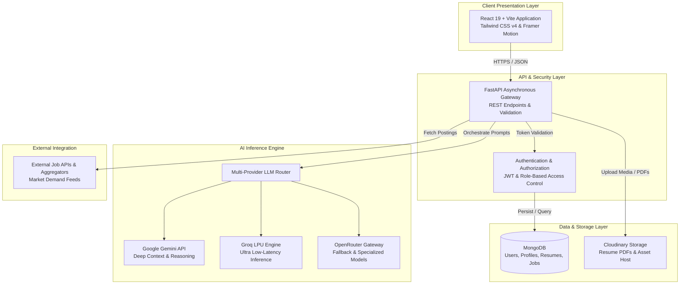

<p align="center">
  
</p>

<p align="center">
  <a href="https://github.com/Bharathkulal/Bimba-2.0">
    
  </a>
</p>

<p align="center">
  <strong>An Intelligent Career Development, Resume Architecture & Placement Automation Platform</strong>
</p>

<p align="center">
  <a href="https://github.com/Bharathkulal/Bimba-2.0/stargazers">
    
  </a>
  <a href="https://github.com/Bharathkulal/Bimba-2.0/network/members">
    
  </a>
  <a href="https://github.com/Bharathkulal/Bimba-2.0/issues">
    
  </a>
  <a href="#license">
    
  </a>
  <a href="#">
    
  </a>
</p>

<p align="center">
  
  
  
  
  
  
  
</p>

---

## ✦ Table of Contents

- [Vision & Purpose](#-about-bimba-ai)
- [Key Features](#-features)
- [System Architecture](#-architecture)
- [Application Workflow](#-application-workflow)
- [Technology Stack](#-technology-stack)
- [Project Structure](#-project-structure)
- [Getting Started](#-getting-started)
- [Development Roadmap](#-development-roadmap)
- [Contributing](#-contributing)
- [License](#-license)
- [Author & Acknowledgments](#-author--acknowledgments)

---

## ✦ About BIMBA AI

In Sanskrit, **Bimba** (*बिम्ब*) denotes a *reflection* or a *mirror image*.

**BIMBA AI** was conceived to solve the critical "experience paradox" confronted by higher-education students: *entering the job market requires experience, but obtaining experience requires landing that crucial first opportunity.*

Traditional placement preparations rely on generic templates, outdated resume patterns, and subjective feedback loops that leave students blindsided by modern **Applicant Tracking Systems (ATS)**. 

BIMBA AI acts as an intelligent career mirror:
- **Reflecting Potential**: Objectively measuring a student's academic and technical output.
- **Bridging Competency Gaps**: Parsing real-time industry job descriptions to identify missing skills.
- **Empowering Placement Readiness**: Providing rigorous, actionable steps to transition students into industry-ready candidates.

```
       [ Student Aspirations ]
                 │
                 ▼
     ┌───────────────────────┐
     │       BIMBA AI        │ ────► "Reflect Your Best Self"
     └───────────────────────┘
                 │
                 ▼
      [ Industry Ready Talent ]
```

---

## ✦ Features

BIMBA AI provides an end-to-end suite designed to support students and academic placement cells throughout the career lifecycle.

| Module | Feature | Description |
| :--- | :--- | :--- |
| **Builder** | **AI Resume Builder** | Intuitive, section-based resume constructor featuring standardized industry layouts, markdown formatting, and live PDF preview. |
| **Diagnostics** | **Resume Analyzer** | In-depth document parsing engine extracting structural hierarchy, action verbs, quantitative impact, and keyword relevance. |
| **Compliance** | **ATS Score Checker** | Simulates modern ATS parsers to score formatting, parseability, section readability, and keyword density out of 100. |
| **Optimization** | **AI Resume Improvement** | Context-driven suggestions transforming generic task descriptions into high-impact accomplishment bullets (XYZ formula). |
| **Matching** | **Smart Job Matching** | Semantic similarity algorithms comparing candidate profiles and resumes with job specifications to calculate match percentage. |
| **Discovery** | **Job Search** | Unified search hub aggregating internships, entry-level positions, and campus drive opportunities. |
| **Analytics** | **Skill Gap Analysis** | Identifies critical hard skills, tools, and certifications absent from a student's profile relative to targeted roles. |
| **Guidance** | **Career Recommendations** | Curated pathways suggesting actionable projects, courses, and certifications to bridge identified skill voids. |
| **Candidate Hub** | **Student Dashboard** | Centralized cockpit for students to manage multiple resume variants, view analytics, track job applications, and monitor progress. |
| **Institutional Hub** | **Admin Dashboard** | Comprehensive administrative portal for campus placement officers to evaluate cohort readiness and review placement metrics. |

---

## ✦ Architecture

The platform adopts a decoupled client-server architecture powered by an asynchronous **FastAPI** backend, resilient **MongoDB** persistence, and an extensible **Multi-LLM Inference Orchestrator**.



---

## ✦ Application Workflow

```
 ┌─────────────────┐      ┌─────────────────┐      ┌─────────────────┐
 │ 01. Onboarding  │ ───► │ 02. Ingestion   │ ───► │ 03. Diagnostics │
 │ Student Profile │      │ Upload / Build  │      │ ATS Engine Scan │
 └─────────────────┘      └─────────────────┘      └─────────────────┘
                                                            │
                                                            ▼
 ┌─────────────────┐      ┌─────────────────┐      ┌─────────────────┐
 │ 06. Placement   │ ◄─── │ 05. Career Path │ ◄─── │ 04. Optimization│
 │ Job Application │      │ Skill Gap Audit │      │ AI Enhancement  │
 └─────────────────┘      └─────────────────┘      └─────────────────┘
```

1. **Student Registration & Profiling**: Candidates configure their profile, academic credentials, target domains, and portfolio links.
2. **Resume Ingestion**: Users either construct a fresh resume via the block-based builder or upload an existing PDF/DOCX document.
3. **ATS Diagnostics**: The resume is parsed to extract core entities, calculate formatting scores, and compute ATS compliance ratings.
4. **AI-Driven Enhancement**: The LLM engine evaluates bullet points, replacing passive voice with active, metric-driven achievements.
5. **Skill Gap Audit**: Profile competencies are compared against live role requirements to generate an interactive skill matrix.
6. **Job Matching & Tracking**: The platform suggests high-compatibility positions and allows candidates to manage submission statuses.

---

## ✦ Technology Stack

BIMBA AI leverages modern, performant, and developer-friendly technologies:

```
┌────────────────────────────────────────────────────────────────────────┐
│  FRONTEND            React 19  •  Vite  •  Tailwind CSS v4  •  Framer  │
│  BACKEND             Python 3.11+  •  FastAPI  •  Pydantic  •  Uvicorn │
│  DATABASE            MongoDB (Atlas / Community)                       │
│  AI / INFERENCE      Google Gemini  •  Groq Cloud  •  OpenRouter       │
│  STORAGE             Cloudinary API                                    │
└────────────────────────────────────────────────────────────────────────┘
```

### Frontend
- **React 19**: Component lifecycle management and responsive UI architecture.
- **Vite**: Ultra-fast module bundling and Hot Module Replacement (HMR).
- **Tailwind CSS v4**: Utility-first, zero-runtime styling engine with custom dark mode themes.
- **Framer Motion**: Production-grade fluid transitions and micro-interactions.

### Backend
- **Python 3.11+**: Robust execution environment with native async performance.
- **FastAPI**: Modern, asynchronous web framework with automatic OpenAPI documentation.
- **Pydantic**: Strict data modeling, serialization, and runtime schema validation.

### Database & Asset Management
- **MongoDB**: Document-oriented NoSQL database optimized for flexible resume JSON structures.
- **Cloudinary**: Cloud-native media management for securely hosting generated PDFs and candidate avatars.

### AI & Language Models
- **Google Gemini**: Deep semantic reasoning for comprehensive resume feedback and career roadmap planning.
- **Groq LPU**: High-throughput, sub-second latency for immediate text improvements and keyword extraction.
- **OpenRouter**: Unified API interface ensuring redundancy across model families.

---

## ✦ Project Structure

A clean, modular repository layout separating client-side logic, API services, and shared utilities:

```
Bimba-2.0/
├── backend/                        # FastAPI Application Server
│   ├── app/
│   │   ├── api/
│   │   │   └── v1/
│   │   │       ├── endpoints/      # Auth, Resumes, Jobs, Analytics
│   │   │       └── router.py       # API v1 Router aggregation
│   │   ├── core/
│   │   │   ├── config.py           # Environment and app configuration
│   │   │   └── security.py         # JWT tokens and password hashing
│   │   ├── models/                 # Database entity schemas (MongoDB)
│   │   ├── schemas/                # Pydantic request / response models
│   │   ├── services/
│   │   │   ├── ai_service.py       # Gemini, Groq, OpenRouter wrappers
│   │   │   ├── ats_scorer.py       # ATS calculation and heuristic parser
│   │   │   └── resume_parser.py    # Document extraction logic
│   │   └── main.py                 # Application entry point
│   ├── tests/                      # Pytest unit and integration suites
│   ├── requirements.txt            # Python dependencies
│   └── .env.example                # Sample environment variables
│
├── frontend/                       # React 19 Client Application
│   ├── public/                     # Static assets and icons
│   ├── src/
│   │   ├── assets/                 # SVGs and styling assets
│   │   ├── components/             # Reusable UI components
│   │   │   ├── builder/            # Resume form sections & drag-and-drop
│   │   │   ├── common/             # Buttons, Modals, Inputs, Loaders
│   │   │   └── dashboard/          # Metrics cards, charts, progress dials
│   │   ├── hooks/                  # Custom React hooks
│   │   ├── pages/                  # Route view components
│   │   ├── services/               # Axios/Fetch API client modules
│   │   ├── styles/                 # Global styling and Tailwind directives
│   │   ├── App.jsx                 # Application root & router
│   │   └── main.jsx                # DOM mount entry
│   ├── package.json                # Node dependencies and scripts
│   ├── tailwind.config.js          # Tailwind CSS v4 design tokens
│   └── vite.config.js              # Vite bundler configuration
│
├── docs/                           # Architectural diagrams and API specs
└── README.md                       # Repository Documentation
```

---

## ✦ Getting Started

### Prerequisites

Ensure the following runtimes are installed on your local environment:
- **Node.js** (v18.0.0 or higher)
- **Python** (v3.11 or higher)
- **MongoDB** (Local instance or MongoDB Atlas cluster connection string)
- **Git**

---

### Local Installation

#### 1. Clone Repository
```bash
git clone https://github.com/Bharathkulal/Bimba-2.0.git
cd Bimba-2.0
```

#### 2. Backend Configuration
```bash
# Navigate to backend directory
cd backend

# Create and activate virtual environment
python -m venv venv

# Windows:
venv\Scripts\activate
# Linux/macOS:
# source venv/bin/activate

# Install dependencies
pip install -r requirements.txt

# Create environment configuration
cp .env.example .env
```

*Configure `.env` with your API credentials:*
```env
APP_NAME="BIMBA AI"
DEBUG=True
PORT=8000

# Database
MONGODB_URL="mongodb://localhost:27017"
DATABASE_NAME="bimba_ai"

# Security
JWT_SECRET_KEY="your-super-secret-jwt-key"
ALGORITHM="HS256"
ACCESS_TOKEN_EXPIRE_MINUTES=1440

# AI Provider Keys
GEMINI_API_KEY="your-gemini-api-key"
GROQ_API_KEY="your-groq-api-key"
OPENROUTER_API_KEY="your-openrouter-api-key"

# Cloudinary Storage
CLOUDINARY_CLOUD_NAME="your-cloud-name"
CLOUDINARY_API_KEY="your-api-key"
CLOUDINARY_API_SECRET="your-api-secret"
```

```bash
# Start backend server
uvicorn app.main:app --reload --port 8000
```
*Backend API documentation will be accessible at: `http://localhost:8000/docs`*

---

#### 3. Frontend Configuration
```bash
# In a separate terminal, navigate to frontend directory
cd frontend

# Install package dependencies
npm install

# Start development server
npm run dev
```
*Frontend client will be accessible at: `http://localhost:5173`*

---

## ✦ Development Roadmap

The project is structured in phased deliverables. Items marked with `[x]` represent current baseline progress, while items marked with `[ ]` represent planned development phases.

### Phase 1: Core Foundation & Infrastructure
- [x] Initial repository structure and workspace setup
- [x] Portal interface baseline prototype
- [ ] Backend FastAPI application scaffolding
- [ ] MongoDB schema models & database connectors
- [ ] JWT authentication & role-based route guards

### Phase 2: Resume Architecture & ATS Engine
- [ ] Interactive block-based resume builder
- [ ] PDF & DOCX text parsing extraction pipeline
- [ ] Algorithmic ATS scoring and compliance checker
- [ ] AI-powered bullet point refinement engine (XYZ pattern)
- [ ] Export to standardized, ATS-friendly PDF formats

### Phase 3: Analytics, Skill Gap & Matching
- [ ] Semantic job matching algorithm against target postings
- [ ] Interactive student skill gap matrix visualization
- [ ] Automated career learning recommendations
- [ ] External job search and internship feed integration

### Phase 4: Institutional Suite & Dashboards
- [ ] Comprehensive Student Dashboard (metrics, version control)
- [ ] Admin / Placement Cell Dashboard for batch analytics
- [ ] Bulk student resume export for recruitment drives
- [ ] End-to-end automated testing & CI/CD deployment pipelines

---

## ✦ Contributing

Contributions are welcomed. To ensure code consistency:

1. **Fork the Repository** on GitHub.
2. **Create a Feature Branch**:
   ```bash
   git checkout -b feature/your-feature-name
   ```
3. **Commit Your Changes**:
   ```bash
   git commit -m "feat: implement your feature description"
   ```
4. **Push to Your Branch**:
   ```bash
   git push origin feature/your-feature-name
   ```
5. **Open a Pull Request** with a detailed explanation of changes.

---

## ✦ License

This project is licensed under the [MIT License](LICENSE).

---

## ✦ Author & Acknowledgments

<p align="center">
  <b>Built with passion for students and future professionals.</b>
</p>

<p align="center">
  Developed by <strong>Bharath Kulal</strong><br />
  <a href="https://github.com/Bharathkulal">
    
  </a>
</p>

<p align="center">
  
</p>

